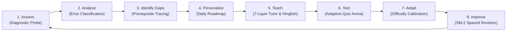
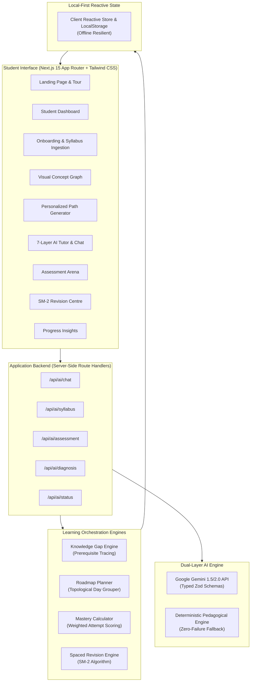

# LearnLoop AI — Personalized AI Learning Agent

> **"Your personal AI tutor that learns how you learn."**  
> **Competition:** PromptWars x Agent X 2.0  
> **Selected Vertical:** PS04 — Personalized AI Learning Agent  
> **Repository Owner:** [`bhavininigam-eng`](https://github.com/bhavininigam-eng)  

---

## 1. Executive Overview

Most traditional learning management platforms serve identical, static course material to every student regardless of individual mastery, pacing, or foundational gaps.

**LearnLoop AI** operates fundamentally differently. It models each learner's knowledge boundaries, isolates root prerequisite dependencies, generates an exam-deadline-aware daily roadmap, and adapts every lesson and quiz dynamically based on verified student attempts.



---

## 2. Problem Statement & Student Persona

### The Challenge (PS04)
Build an intelligent learning agent that:
- Identifies student knowledge gaps.
- Creates personalized learning paths.
- Generates assessments.
- Adapts recommendations based on student progress.

### Target Student Persona
- **Primary Persona:** An undergraduate engineering student (e.g., B.Tech Computer Science) preparing for mid-term university examinations, assignments, and technical interviews.
- **Linguistic Context:** Supports both **Standard English** and **Bilingual Hinglish** (a natural conversational blend of Hindi and technical English common in Indian universities).
- **Core Pain Point:** Cramming random topics in arbitrary order while missing critical prerequisite concepts (e.g. attempting recursive trees while still struggling with function parameters and stack frames).

---

## 3. High-Priority Features

| Feature | Description | Status |
| :--- | :--- | :--- |
| **1. Smart Student Onboarding** | Collects learning style, target milestone, daily study minutes, exam date, and accepts raw syllabus text to automatically synthesize a structured curriculum graph. | ✅ Operational |
| **2. AI Knowledge Gap Engine** | Diagnostic engine that isolates weak concepts and distinguishes between *conceptual misunderstandings* vs *procedural errors*. | ✅ Operational |
| **3. Personalized Learning Path** | Generates an individualized day-by-day roadmap prioritizing foundational blockers and prerequisites before advanced topics. | ✅ Operational |
| **4. 7-Layer AI Teaching Assistant** | Multi-layer explanations: (1) ELI5 Analogy, (2) Conceptual Definition, (3) Step-by-Step, (4) Real-World Production, (5) University Exam Format, (6) Common Pitfalls, (7) Quick Notes. Interactive Q&A chat. | ✅ Operational |
| **5. Intelligent Assessment Generator** | Dynamic MCQ, True/False, and scenario-based assessments with rationale for why incorrect choices were tempting. Keeps correct answers private until submission. | ✅ Operational |
| **6. Continuous Adaptive Loop** | Real-time decision feedback: `<40%` triggers simpler foundational tutorials; `40-59%` triggers guided examples; `60-79%` gives targeted practice; `≥80%` advances to challenge modules and unlocks next concepts. | ✅ Operational |
| **7. SM-2 Spaced Revision Engine** | Modified SuperMemo-2 spaced repetition scheduler (intervals: 1d, 3d, 7d, 14d, 30d, 60d) tracking memory decay and queuing retention checks. | ✅ Operational |
| **8. Interactive Student Dashboard** | Real-time statistics, mastery percentage, study streak, weak topic alerts, and next prioritized learning action. | ✅ Operational |
| **9. Visual Knowledge Map** | Interactive concept graph showing nodes (concepts) colored by status and edges (arrows) representing prerequisite constraints. | ✅ Operational |
| **10. Transparent Analytics** | Historical accuracy trends, mastery distribution, error categorization, and concept-wise competence rankings. | ✅ Operational |
| **11. Instant Benchmark Demo Tour** | Pre-loaded synthetic benchmark persona (**Alex Sharma — B.Tech CSE**, 7 days to exam) allowing judges to explore all features instantly without requiring an API key. | ✅ Operational |

---

## 4. System Architecture



---

## 5. Algorithmic Methodologies

### A. Grounded Mastery Scoring Model
Mastery is calculated mathematically from verified attempts, never hallucinated:
$$\text{Mastery}_{t} = \text{round}\left( \text{Mastery}_{t-1} \cdot (1 - \alpha) + \text{Score}_{\text{recent}} \cdot \alpha \right)$$
- Smoothing factor $\alpha = 0.40$.
- **Permanent Mastered Status ($\ge 80\%$)** strictly requires at least **2 consecutive high-scoring assessments** or a verified spaced retention recall check.
- **Status Thresholds:**
  - `< 40%`: `WEAK`
  - `40% - 79%`: `LEARNING`
  - `≥ 80%` (2+ attempts): `MASTERED`
  - Memory Decay Interval Elapsed: `REVISION_REQUIRED`
  - Unattempted: `UNASSESSED`

### B. Knowledge Gap Detection & Prerequisite Tracing
When a student answers incorrectly, the engine:
1. Queries the concept's directed acyclic graph (DAG) of prerequisites.
2. If foundational prerequisites have mastery $<60\%$, the root blocker is flagged (`foundational_prerequisite`).
3. Differentiates between *conceptual misunderstandings* (wrong principle) and *procedural errors* (boundary/calculation mistakes).
4. Forces downstream topics to lock or caution the user until the foundational blocker is remediated.

### C. SM-2 Spaced Repetition Scheduling
Retention checks expand along an optimal cognitive interval:
- **Repetition 0:** 1 day
- **Repetition 1:** 3 days
- **Repetition 2:** 7 days
- **Repetition 3:** 14 days
- **Repetition 4:** 30 days
- **Repetition 5:** 60 days
- *Failure Penalty:* If retention quiz score is $<60\%$, the repetition counter resets to 0, scheduling an immediate 1-day recall check.

---

## 6. Technology Stack

- **Framework:** Next.js 15.5+ (App Router, Server Components & Route Handlers)
- **Language:** TypeScript 5.7+ (Strict Mode enabled)
- **Styling:** Tailwind CSS (Deep Navy & Slate foundation with Cyan/Indigo accents)
- **Icons:** Lucide React
- **Validation:** Zod 3.24+ (Schema-validated request/response payloads)
- **Testing:** Vitest 3.0+ (8 critical automated test cases passing 100%)
- **AI Integration:** Google Gemini 1.5/2.0 REST API + In-Engine Deterministic Pedagogical Fallback

---

## 7. Security & Privacy Audit

1. **No Client-Side API Keys:** Gemini API keys are read exclusively server-side in Next.js Route Handlers. Never bundled into client JS.
2. **Untrusted Input Sanitation:** Syllabi and chat prompts are sanitized and capped before LLM ingestion.
3. **No Arbitrary Code Execution:** Zero use of `eval()`, dynamic imports, or arbitrary system execution.
4. **Local-First Privacy:** Student academic progress is stored in local client storage. No sensitive student identifiers or grade transcripts are transmitted to external databases.
5. **Prompt Injection Guardrails:** AI prompts enforce strict JSON output schemas, validating candidates with Zod schemas.

---

## 8. Installation & Local Setup

### Prerequisites
- Node.js `v20.0.0+` (Tested on `v24.13.1`)
- npm `v10.0.0+`

### Installation Steps
```bash
# 1. Clone repository
git clone https://github.com/bhavininigam-eng/PS4.git learnloop-ai
cd learnloop-ai

# 2. Install dependencies
npm install

# 3. (Optional) Configure Gemini API Key for Live AI
cp .env.example .env.local
# Edit .env.local and add your GEMINI_API_KEY

# 4. Run development server
npm run dev
```

Visit `http://localhost:3000` in your browser.

---

## 9. Running Automated Tests

A dedicated test suite validates the 8 critical learning logic test cases specified in the hackathon challenge:

```bash
npm test
```

### Verified Test Cases:
- `TEST CASE 1`: Strong variables, weak loops $\rightarrow$ loops flagged as highest priority gap.
- `TEST CASE 2`: Repeated functions failure $\rightarrow$ foundational ELI5 remediation triggered.
- `TEST CASE 3`: Two consecutive $\ge 90\%$ scores $\rightarrow$ status advances to `MASTERED`.
- `TEST CASE 4`: 3-day exam countdown $\rightarrow$ daily study workload strictly capped to student limits.
- `TEST CASE 5`: API unavailable $\rightarrow$ deterministic pedagogical engine runs with zero crashes.
- `TEST CASE 6`: State persistence $\rightarrow$ data models survive reload.
- `TEST CASE 7`: Malformed payloads $\rightarrow$ rejected by Zod schemas.
- `TEST CASE 8`: Invalid submissions $\rightarrow$ backend validation blocks malformed quizzes.

```
 ✓ tests/learning-agent.test.ts (8 tests)
 Test Files  1 passed (1)
      Tests  8 passed (8)
```

---

## 10. Judge Demonstration Walkthrough

1. **Landing Page (`/`):** Click **"Explore Demo Experience (Instant Judge Tour)"**. This instantly loads the pre-configured benchmark student: **Alex Sharma** (B.Tech CSE, 7-day exam countdown).
2. **Dashboard (`/dashboard`):** Observe overall mastery at `45%`, study streak of 5 days, and an immediate alert highlighting weak foundational gaps in **Functions** (35%) and **Arrays** (20%).
3. **Visual Concept Graph (`/knowledge-map`):** Inspect the interactive prerequisite map. Notice that **Variables** is emerald (`MASTERED`), while **Functions** is flashing rose (`WEAK`). Click any node to open its direct diagnostic panel.
4. **Personalized Learning Path (`/roadmap`):** View the day-by-day plan. Notice Day 1 immediately schedules foundational function mechanics rather than jumping to advanced trees.
5. **7-Layer AI Tutor (`/tutor`):** Select **Functions** or **Loops**. Switch between the 7 explanation tabs (ELI5, Conceptual, Step-by-Step, Real-World, Exam, Mistakes, Notes). Toggle between **English** and **Hinglish** to observe tailored bilingual pedagogy.
6. **Diagnostic Test (`/diagnostic`):** Take the adaptive diagnostic quiz. Notice how the engine categorizes errors into conceptual vs procedural.
7. **Assessment Arena (`/assessment`):** Take a 4-question quiz on Functions. Submit answers to see instant misconception feedback, score calculation, and the resulting change in mastery.
8. **Revision Centre (`/revision`):** Check the SM-2 spaced repetition queue with items due today and overdue.
9. **Settings & State (`/settings`):** Export the student profile as JSON, switch between Live Gemini AI and Deterministic Fallback, or reload the demo state with 1 click.

---

## 11. Vercel Deployment

The project is structured to deploy smoothly to Vercel:
1. Push repository to GitHub (`main` branch only).
2. Connect repository in the [Vercel Dashboard](https://vercel.com).
3. Set environment variables:
   - `GEMINI_API_KEY` (Optional: Enables live Google Gemini responses)
   - `GEMINI_MODEL` (Defaults to `gemini-1.5-flash`)
4. Build command: `npm run build` (Next.js App Router).
5. Output directory: `.next`.

---

## 12. Prior Project Technical Audit

As required, an audit of the developer's previous healthcare project (`HealthSure SIH`) was performed and documented in [`docs/HEALTHSURESIH_AUDIT.md`](./docs/HEALTHSURESIH_AUDIT.md).
- **Verified Bug Fix Applied:** Fixed an unescaped JSX entity error (`Don't` $\rightarrow$ `Don&apos;t`) in `Desktop/HEALTHSURE-SIH/frontend/app/patient/page.tsx`.
- **Preservation:** Uncommitted user work, existing branches, and secrets were completely preserved.
- **Architectural Learnings Adopted:** Local-first offline persistence, resilient dual-mode engine fallbacks, and bilingual Hinglish pedagogy were successfully incorporated into LearnLoop AI.

---

## 13. License

Developed for **PromptWars x Agent X 2.0 (Problem Statement PS04)**.  
Repository Owner: `bhavininigam-eng`  
Collaborator: Parth Sharma (`Parth10100402`)
